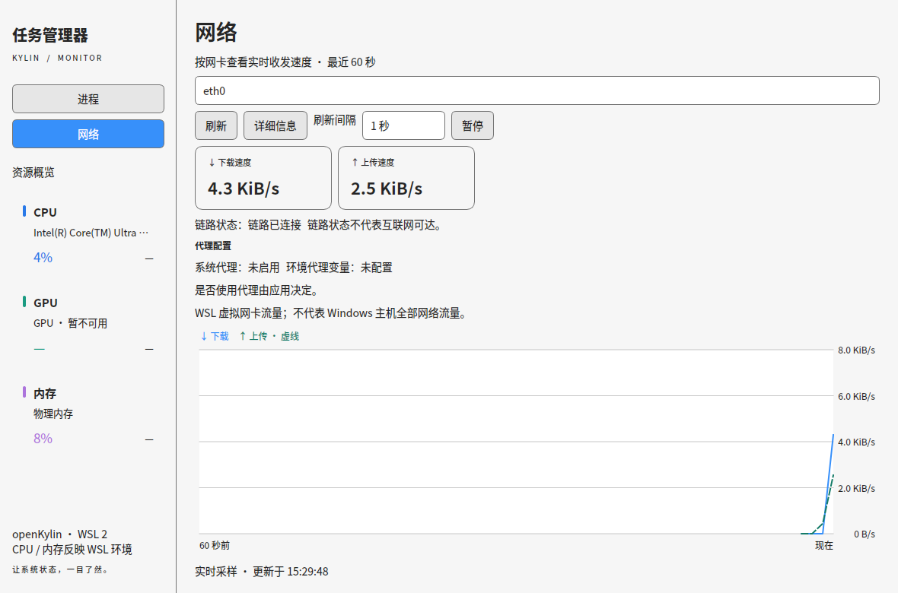
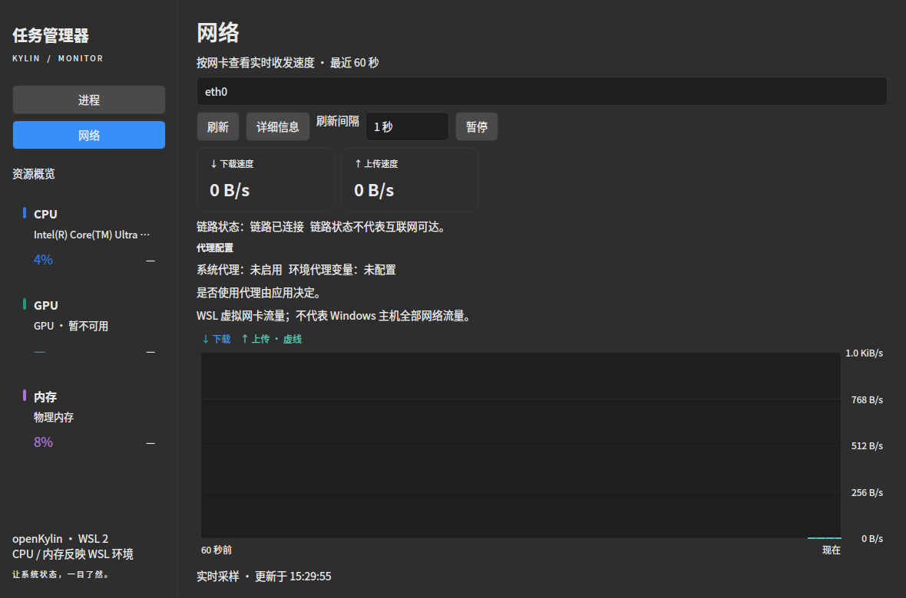
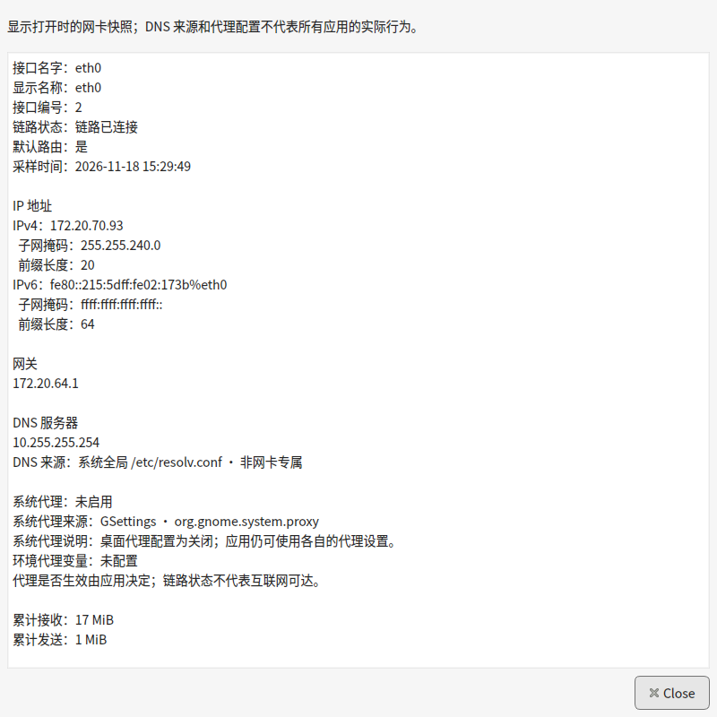

# 网络监控（1.3.0）

在独立任务管理器左侧选择“网络”，或直接启动：

```bash
/usr/bin/kylin-monitor --network
```

网络页显示所选网卡的下载、上传速度、最近 60 秒曲线、链路状态和代理配置。
“详细信息”提供可选择复制的只读文本，包括地址、掩码、网关、DNS 来源和累计收发量。
网络模块独立于 CPU / GPU / 内存采集器；Peony 桌面插件继续显示原有资源柱状图。

## 选择网卡

顶部下拉框可以选择物理网卡、虚拟网卡或回环接口。还没有保存选择时，程序依次选择：

1. 已启用、具有默认路由且不是回环的网卡。
2. 已启用且不是回环的网卡。
3. 列表中的第一张网卡。

若有多个符合条件的接口，选取列表中的第一个，也可以手动切换。这只决定展示哪个接口，
不修改系统路由，也不保证所选接口承担某个应用的流量。当前选择不会随默认路由变化自动切换。
选中的接口消失后，列表保留“接口不可用”条目，避免悄悄改为另一张网卡；接口恢复或手动选择后继续查看。

页面按单个接口显示数据，不合计网桥、隧道、物理接口等可能重复经过同一批数据的计数。
“链路已连接”来自系统接口状态，不能据此判断 DNS、互联网或某个网站是否可达。

## 速度和曲线的含义

下载速度是接口接收字节的增量，上传速度是接口发送字节的增量，均除以两次采样之间的实际单调时钟时间。
这些值来自 `/sys/class/net/<接口>/statistics/rx_bytes` 和 `tx_bytes`，不使用模拟数据，也不通过主动测速产生流量。
字节计数先于 DNS、代理等配置查询采集，配置查询耗时不会被误当作固定刷新间隔。

基础单位为 **B/s（字节/秒）**，界面按 1024 换算为 KiB/s、MiB/s 等；不是 bit/s，也不是网卡标称带宽。
数据包括此接口上的各种通信，不能当作单个应用或单个下载任务的速度。详情中的累计值来自系统接口计数，
不是本程序启动以来的累计下载量，接口重建或系统重新启动后可能重置。

首次采样需要建立基线，因此显示“—”。接口断连、消失、重建、计数回退、计数读取失败或采样时间无效时，
相应速率也显示“—”；连续有效计数确实没有增加时才显示 `0 B/s`。重新连接或重新进入页面后，需等待下一次有效采样。

曲线保留最近 60 秒，实线为下载、虚线为上传，纵轴按当前历史峰值调整。
缺失读数、接口身份变化和采样中断会断开曲线，不将未知区间连接成连续流量。

## 刷新、暂停和配置缓存

网络采样在后台线程执行，仅在网络页可见且窗口未最小化时自动采样。切换页面、隐藏详细窗口或进入极简模式时，
网络采样停止；重新显示网络页时重新建立速率基线。

刷新间隔可选 0.5、1、2 或 5 秒，与进程页、性能页和独立悬浮窗共用设置。
“暂停”保留当前显示；暂停期间点击“刷新”可取得一次新快照，随后仍保持暂停。
网关、DNS 和代理配置约每 5 秒重新读取一次，实际更新时间取决于页面可见性及采样时机。
“刷新”会立即请求重新读取这些配置，并保留连续采样的流量基线；从暂停或隐藏恢复时会单独重建基线。

## 地址、网关与 DNS

“详细信息”显示**打开对话框时的快照**。要查看后来发生的变化，关闭详情，在网络页刷新后重新打开。
详情使用纯文本，长地址和设备名可换行、滚动和复制。

| 字段 | 含义与来源 |
| --- | --- |
| 接口名字、编号、状态 | Qt Network 提供的接口信息 |
| IPv4 / IPv6 地址 | 当前接口的全部可读取地址 |
| 子网掩码、前缀长度 | 每条地址对应的掩码及前缀；缺失时显示未提供 |
| 默认路由、网关 | `/proc/net/route`、`/proc/net/ipv6_route` 中该接口的默认路由；IPv6 链路本地网关带接口作用域 |
| DNS 服务器 | 优先使用 NetworkManager 为此接口提供的 IPv4 / IPv6 DNS |
| DNS 来源 | 区分接口专属信息、系统全局解析器配置及本地 DNS 存根 |

DNS 查询使用只读 `nmcli`，有等待时间限制，不通过 shell 拼接接口名或执行命令。
当 NetworkManager 不可用、超时或没有提供该接口的 DNS 时，回退读取 `/etc/resolv.conf`，
并明确标注“系统全局”“非网卡专属”。若包含 `127.0.0.53`、`::1` 等回环地址，还会标注本地 DNS 存根；
这些地址代表本地解析服务，不能据此推断它实际使用的上游 DNS。

没有显示网关或 DNS 时，应结合详情中的读取说明判断。直连接口可以没有网关，
而无法读取配置也不能证明系统没有配置。页面不修改 IP、路由、DNS，也不探测 DNS 服务是否正常。

## 代理配置

页面分别展示两种信息：

- **系统代理**：读取当前用户的 `org.gnome.system.proxy` 桌面模式，显示未启用、手动、自动或未知。
  工具不可用、超时或返回未知值时显示未知，不推断为关闭。
- **环境代理变量**：检查本程序继承的 `http_proxy`、`https_proxy`、`all_proxy` 及其大写形式，
  仅列出已设置的变量名。`NO_PROXY` / `no_proxy` 是例外规则，不单独代表启用了代理。

桌面模式为“未启用”而环境代理变量“已配置”是可能的，两项来源不同。浏览器、终端程序等还可以有各自的代理设置，
因此这里显示的是**配置信息，不是流量经过代理的检测结果**。环境信息仅限本程序继承的环境，
不能代表其他已运行应用、另一个终端或 Windows 宿主。

程序不查询桌面代理的主机、认证信息或 PAC URL，不下载或执行 PAC；环境变量只判断是否非空，其值不会进入网络快照、界面或设置。
用户名、密码、令牌及含凭据的代理 URL 不会在这项功能中展示或持久化。

## 持久化与 WSL 范围

正常退出时，独立应用通过 `QSettings` 保存最后访问页面、网卡名称、刷新间隔和窗口位置。
Linux 上通常位于 `~/.config/KylinMonitor/kylin-monitor.conf`，设置 `XDG_CONFIG_HOME` 时随之改变。
网卡地址、DNS、代理信息、累计计数和流量曲线不写入该配置；最近 60 秒历史仅保存在内存中。
卸载应用保留用户设置，重新安装后可恢复网卡选择。

在 WSL 中，页面显示当前 Linux 环境可见的虚拟接口及流量，例如 `eth0`。
这些数据不涵盖 Windows 主机所有网卡、应用流量或系统代理设置。
WSL 自动生成的解析器配置按实际内容展示，不将其转述为物理网卡专属 DNS。

## 截图和验证入口

浅色网络页：



深色网络页：



网卡详细信息：



编译后可运行网络模块测试：

```bash
ctest --test-dir build-openkylin --output-on-failure -R 'network_|proxy_reader'
```

重新采集页面和详情截图：

```bash
bash scripts/capture-network.sh
```

测试包含可注入的接口信息、计数文件、路由、DNS、代理和后台采样状态，便于检查首次未知、真实零速率、
计数回退、断连恢复、配置缓存及暂停 / 隐藏后的行为。测试夹具与日常运行的真实采集入口分离。

## 代码组织

| 位置 | 职责 |
| --- | --- |
| `src/domain/network_types.h` | 网络地址、接口、代理及快照值类型 |
| `src/backend/network_collector.*` | 接口信息、sysfs 流量、路由及 DNS 采集 |
| `src/backend/proxy_reader.*` | 桌面代理模式与环境变量名读取 |
| `src/backend/network_sampling_thread.*` | 后台采样、配置刷新、暂停及恢复基线 |
| `src/backend/network_service.*` | 主线程接口与过期快照过滤 |
| `src/ui/network_page.*` | 网卡选择、操作按钮和状态展示 |
| `src/ui/network_history_chart.*` | 网络速度历史与断点曲线 |
| `src/ui/network_rate_card.*` | 随字体适配的速度卡片 |
| `src/ui/network_details_dialog.*` | 可复制的只读详情 |
| `src/ui/network_presentation.*` | 速率单位、链路和代理状态的统一文字 |
| `src/app/network_controller.*` | 网络服务与页面接线 |

接口依据：[Qt Network](https://doc.qt.io/qt-6/qnetworkinterface.html)、
[Linux 网络统计](https://www.kernel.org/doc/html/v6.13/networking/statistics.html)、
[NetworkManager nmcli](https://networkmanager.pages.freedesktop.org/NetworkManager/NetworkManager/nmcli.html)。
